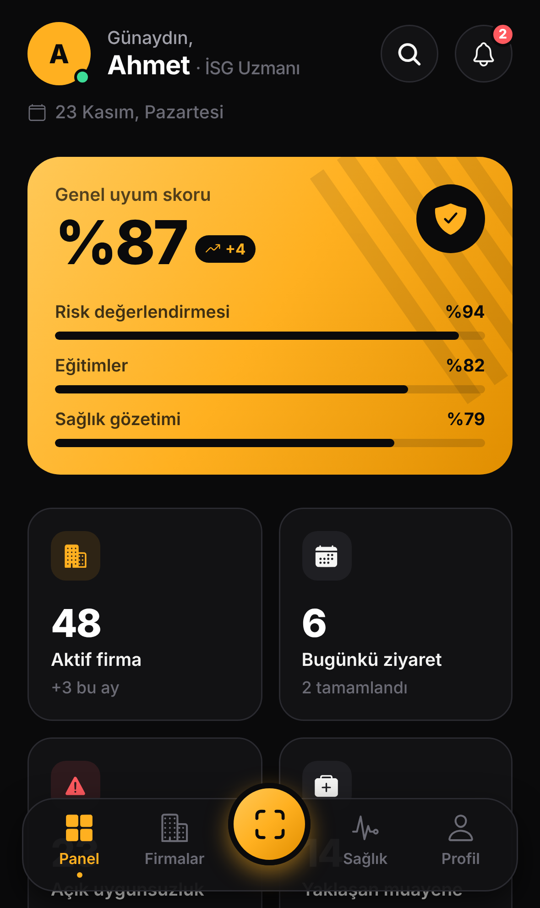
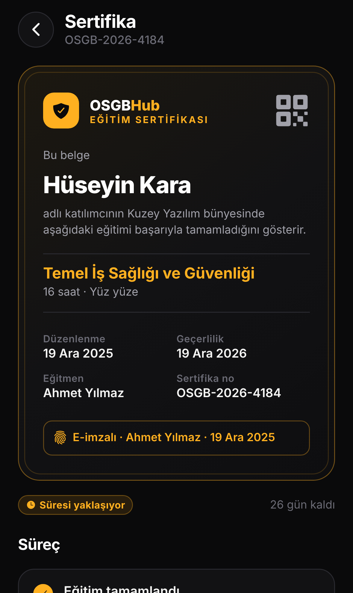
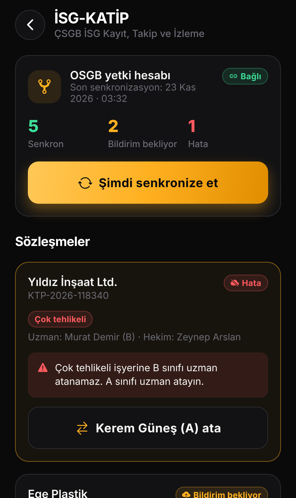

# OSGB Hub — Mobil

İş Sağlığı ve Güvenliği (OSGB) yönetim platformunun mobil uygulaması.
Tasarım dili: **siyah · amber · beyaz**. Telefon, tablet ve bilgisayarda çalışır:
telefonda alt sekme çubuğu, bilgisayarda (≥1024px) sol kenar menü ve çok sütunlu yerleşim.

   

## Modüller

| Modül | Ne yapar |
|---|---|
| **Panel** | Genel uyum skoru, bekleyen işler, KPI'lar, aylık sertifika grafiği, sertifika durum dağılımı, yaklaşan eğitimler, riskli firmalar, ekip çalışma süresi |
| **Firmalar** | Tehlike sınıfı / KATİP filtresi, eğitim uyumu, firma detayı (ekip, sözleşme, personel, eğitimler) |
| **Ekip** | İSG uzmanı (A/B/C), işyeri hekimi, DSP; İSG-KATİP asgari süreye göre kapasite, sınıf uyumsuzluğu uyarısı |
| **Eğitimler** | Eğitim kataloğu (konu, süre, geçerlilik) ve atamalar |
| **Eğitim atamaları** | Eğitim → firma → eğitmen → tarih → katılımcı; "sertifikası eksik olanlar" kısayolu; yoklama ve tamamlama |
| **Katılımcılar** | Firma personeli, arama, kişi bazında sertifika geçmişi |
| **Sertifikalar** | Geçerli / yaklaşan / süresi dolmuş / süreçte filtreleri, sertifika görseli ve süreç zaman çizelgesi |
| **Sertifika onayları** | Eğitim oturumu bazında toplu onay, gerekçeli ret |
| **E-imza** | Onaylı sertifikalar ve belgeler için toplu imza (mobil imza / e-imza kartı + PIN) |
| **İSG-KATİP** | Sözleşme senkron durumu, hata açıklaması, uygun uzman atama önerisi, işlem günlüğü |

**İş akışı (yüz yüze):** Eğitim ata → eğitimi başlat → yoklama ile tamamla → sertifikalar onaya düşer → onayla → e-imza → geçerli sertifika.

### Online eğitim sistemi

- **Katılımcı hesapları:** katılımcı detayından tek tek ya da Katılımcılar ekranından toplu oluşturulur (e-posta + geçici şifre; ilk girişte değiştirilmesi istenir).
- **Katılımcı portalı:** giriş sayfasında “Katılımcı” seçilerek girilir → Eğitimlerim, Sertifikalarım, Hesabım.
- **Akış:** ön sınav → dersler sırayla (slayt dersleri, video dersleri — videonun en az %90'ı gerçekten izlenmeli, ileri sarma sayılmaz) → süreli final sınavı (geçme notu, deneme hakkı).
- **Final geçilince** sertifika otomatik olarak yöneticinin onay kuyruğuna düşer. Yönetici katılımcının puanlarını, verdiği cevapları ve çalışma süresini inceleyip onaylar/reddeder; hakkı biten katılımcıya ek hak tanıyabilir.
- **İçerik editörü:** yeni eğitim, ders ekleme/sıralama, slayt (başlık, maddeler, görsel), video adresi, ön/final sınav soruları, geçme notu ve deneme hakkı.
- **Demo hesaplar:** “Demo yönetici” ve “Demo katılımcı” butonları (katılımcı: `demo.katilimci@osgbhub.com` / `demo1234`).

## Teknoloji

- **Expo SDK 58** · React Native 0.88 · React 19.3 · TypeScript 6 (strict)
- **Expo Router**: dosya tabanlı yönlendirme, `Stack.Protected` ile oturum koruması
- expo-linear-gradient, expo-haptics, @expo/vector-icons

## Başlatma

```bash
npm install
npx expo start      # QR kodu Expo Go ile okutun
npm run web         # tarayıcıda çalıştır
npm run typecheck
npm run lint
```

## Web yayını (Cloudflare · osgbhub.com)

Web sürümü Cloudflare Workers üzerinde statik dosya olarak yayınlanır. Ayarlar `wrangler.jsonc` içinde:
`dist/` klasörü yayınlanır, derin bağlantılar `index.html`'e düşer, `osgbhub.com` ve `www.osgbhub.com`
deploy sırasında otomatik bağlanır. Önbellek ve güvenlik başlıkları `public/_headers` dosyasındadır.

```bash
npm run build:web   # dist/ klasörünü üretir
npm run deploy      # derler ve Cloudflare'e yükler (wrangler login gerekir)
```

Cloudflare panelinde GitHub bağlantısı (Workers Builds) için:
build komutu `npm run build:web`, deploy komutu `npx wrangler deploy`.

## Klasör yapısı

```
src/
  app/
    _layout.tsx          # oturuma göre korumalı yönlendirme
    login.tsx
    (app)/
      (tabs)/            # dashboard, firms, trainings, more
      firm/[id].tsx  training/[id].tsx  participant/[id].tsx  certificate/[id].tsx
      assignment/[id].tsx  assignment/new.tsx
      team.tsx  participants.tsx  certificates.tsx  approvals.tsx
      e-signature.tsx  isg-katip.tsx  profile.tsx
  components/            # TabBar, QuickActionsSheet, charts, domain, ui/*
  data/
    types.ts             # veri modeli
    seed.ts              # deterministik demo verisi
    store.ts             # paylaşılan durum, iş akışı aksiyonları, hesaplamalar
  lib/                   # auth (mock), session, format
  theme/                 # renk, boşluk, köşe token'ları
```

## Notlar

- **Demo modu:** başlangıç verisi `src/data/seed.ts` ve `src/data/content.ts` içindedir. Değişiklikler cihazda saklanır (web: localStorage, telefon: AsyncStorage); Profil → “Demo verilerini sıfırla” ile başa dönülür. Farklı cihazlar veriyi paylaşmaz — çok kullanıcılı gerçek kullanım için sunucu gerekir.
- Katılımcı şifreleri ve sınav cevap anahtarları demo gereği cihazda tutulur; canlıda sunucuda (hash'li şifre, sunucu tarafı puanlama) olmalıdır.
- Giriş mock'tur; hata durumunu denemek için şifre olarak `hatali123` girin.
- **E-imza** ve **İSG-KATİP** şu an simülasyondur. Canlıya geçmek için sunucu tarafında
  e-imza sağlayıcısı (mobil imza / NES) entegrasyonu ve OSGB'nin İSG-KATİP web servis yetkisi gerekir.
- İSG-KATİP süre hesapları çalışan başına aylık asgari dakikalara göre yapılır
  (uzman: 10/20/40, hekim: 5/10/15, DSP: çok tehlikelide 10 dk).
