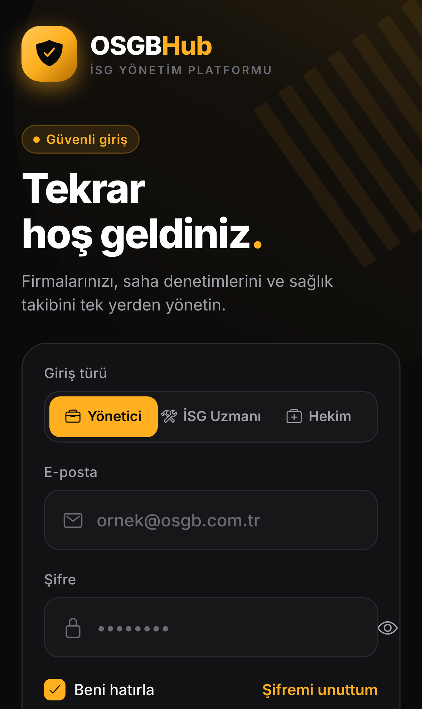

# OSGB Hub — Mobil

İş Sağlığı ve Güvenliği (OSGB) yönetim platformunun mobil uygulaması.
Tasarım dili: **siyah · amber · beyaz**, mobil öncelikli.

 

## Teknoloji

- **Expo SDK 58** · React Native 0.88 · React 19.3
- **Expo Router** (dosya tabanlı yönlendirme, `src/app/`)
- **TypeScript 6** (strict)
- expo-linear-gradient, expo-haptics, @expo/vector-icons

## Başlatma

```bash
npm install
npx expo start      # QR kodu Expo Go ile okutun
npm run web         # tarayıcıda çalıştır
npm run typecheck
```

## Klasör yapısı

```
src/
  app/            # ekranlar (Expo Router)
    _layout.tsx
    _layout.tsx   # oturuma göre korumalı yönlendirme (Stack.Protected)
    index.tsx     # → /login veya /dashboard
    login.tsx     # giriş ekranı
    (tabs)/       # sekmeli alan: dashboard, firms, inspections, health, profile
  components/     # paylaşılan bileşenler (TabBar, dashboard/*, ui/*)
  data/           # geçici panel verileri
  lib/auth.ts     # doğrulama + geçici (mock) giriş servisi
  lib/session.tsx # bellek içi oturum (context)
  theme/          # renk, boşluk, köşe yarıçapı token'ları
```

## Notlar

- Giriş şu an **mock** servistir (`src/lib/auth.ts`). Hata durumunu denemek için şifre olarak `hatali123` girin.
- Panel verileri `src/data/dashboard.ts` içindeki örnek verilerdir.
- Oturum bellekte tutulur; web'de sayfa yenilenince giriş ekranına dönülür.
